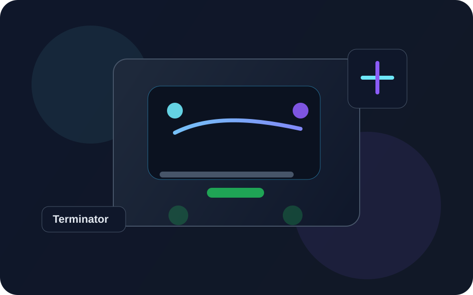

# Terminator_lite

<p align="center">
  
</p>

<div align="center">
  
  
  
</div>

Terminator_lite je osobní robotický projekt zaměřený na vývoj, testování a postupné budování funkčního robota, který bude ovládán pomocí mobilní aplikace, hlasových příkazů a inteligentních senzorů.

Cílem je vytvořit přehledný a rozšiřitelný repozitář, ve kterém je možné sledovat vývoj od první myšlenky až po prototyp a pozdější vylepšení.

## Co je v projektu

- Architektura robota a návrh funkčních modulů
- Výběr hardwarových komponent a jejich popis
- Postup vývoje a poznámky z experimentů
- Dokumentace pro spuštění projektu a další rozšíření
- Vizuální přehled repozitáře pro snadnější orientaci

## Rychlý náhled

<section class="feature-grid">
  <div class="feature-card">
    <h3>Robotika</h3>
    <p>Vývoj základního robota s pohyblivou strukturou, motory, senzory a elektronickým návrhem.</p>
  </div>
  <div class="feature-card">
    <h3>AI a ovládání</h3>
    <p>V budoucnu plánované hlasové ovládání, navigace a inteligentní akce na základě dat z kamery a IMU.</p>
  </div>
  <div class="feature-card">
    <h3>Dokumentace</h3>
    <p>Reprezentativní README, technické poznámky a rozcestník pro další práci na projektu.</p>
  </div>
</section>

## Struktura repozitáře

```text
Terminator_lite/
├── README.md                  # Hlavní přehled projektu
├── index.html                 # Vizuální landing page
├── styles.css                 # Styl pro landing page
├── assets/
│   └── terminator-hero.svg   # Ilustrace projektu
├── docs/
│   ├── README.md              # Dokumentační rozcestník
│   ├── STARTUP.md             # Rychlý návod pro spuštění
│   ├── ROADMAP.md             # Plán rozvoje robota
│   └── SOFTWARE_OVERVIEW.md   # Přehled softwaru a poznámky
├── .devcontainer/
│   └── devcontainer.json      # Konfigurace GitHub Codespaces
├── informace o sofrwaru       # Původní poznámka (archivní)
├── postup                     # Původní záznam o průběhu projektu (archivní)
└── .github/                   # Případné workflow soubory, pokud budou přidány
```

## Rychlý start

### Lokálně

1. Naklonujte repozitář:

```bash
git clone https://github.com/pikamates21/Terminator_lite.git
cd Terminator_lite
```

2. Otevřete index.html v prohlížeči nebo spusťte lokální server:

```bash
python3 -m http.server 8000
```

3. Poté otevřete v prohlížeči adresu `http://localhost:8000`.

### GitHub Codespaces

1. Otevřete repozitář na GitHub.
2. Klikněte na tlačítko `Code` a vyberte `Codespaces`.
3. Po vytvoření prostředí se automaticky použije konfigurační soubor v `.devcontainer`.
4. Můžete pracovat s projektem, upravovat dokumentaci nebo rozšiřovat návrh webové landing page.

## Dokumentace

- `docs/README.md` – hlavní dokumentační rozcestník
- `docs/STARTUP.md` – návod ke spuštění a vývoji
- `docs/ROADMAP.md` – plán vývoje robota
- `docs/SOFTWARE_OVERVIEW.md` – přehled software a experimentů

## Vývojový plán

V současné době je projekt v počáteční fázi, kdy se řeší:

- výběr vhodných motorů a periferií
- návrh architektury robota
- software a základní koncepce systému
- zajištění přehledné dokumentace pro další rozvoj

## Poznámka

Tento repozitář byl upraven tak, aby byl vizuálně přehlednější, lépe strukturovaný a snadnější pro další práci i prezentaci projektu.

---

Pro více informací otevřete dokumentaci v adresáři `docs/` nebo navštivte `index.html` pro vizuální přehled projektu.
